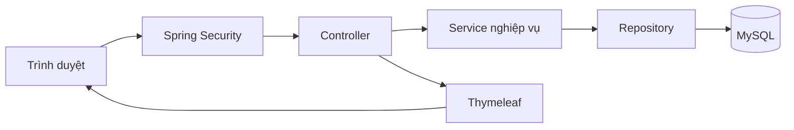

# Implementation plan — Sàn thương mại điện tử lấy cảm hứng từ Shopee

Ngày lập: 12/11/2026. Trạng thái: kế hoạch thiết kế, chưa triển khai mã nguồn.

## 1. Định hướng dành cho bạn

Bạn đã có Java Core, OOP và database fundamentals. Dự án này sẽ nối ba phần đó thành một ứng dụng web hoàn chỉnh: trình duyệt gửi yêu cầu, Java xử lý nghiệp vụ, MySQL lưu dữ liệu, rồi giao diện hiển thị kết quả.

**Lựa chọn đề xuất: Java 21 + Spring Boot + MySQL + Thymeleaf, kiến trúc modular monolith.** Modular monolith là một ứng dụng chạy và triển khai chung, nhưng mã nguồn chia thành các module theo nghiệp vụ như tài khoản, sản phẩm, giỏ hàng và đơn hàng.

Mục tiêu là một sản phẩm portfolio có luồng mua bán chạy thật trên dữ liệu demo, đồng thời giúp bạn giải thích được quyết định thiết kế. “Chuẩn thực tế” trong dự án này nghĩa là yêu cầu rõ ràng, dữ liệu nhất quán, phân quyền đúng, có kiểm thử và có thể triển khai lại từ hướng dẫn.

Giả định: bạn làm một mình, ưu tiên học backend Java, chưa cần thành thạo JavaScript. Phạm vi đầu tiên dùng tiếng Việt, tiền VND và thanh toán COD mô phỏng. Thời gian dưới đây là ước lượng học và làm, không phải cam kết tiến độ.

## 2. Chốt phạm vi sản phẩm trước khi viết code

### MVP — phiên bản nhỏ nhất có luồng sử dụng hoàn chỉnh

MVP có nhiều shop, mỗi tài khoản sở hữu tối đa một shop. Người bán vẫn có thể mua hàng ở shop khác. Giỏ hàng chứa sản phẩm từ nhiều shop, nhưng **mỗi lần checkout chỉ chọn một shop và tạo một đơn cho shop đó**.

| Người sử dụng | Chức năng trong MVP |
|---|---|
| Khách chưa đăng nhập | Xem danh mục, tìm kiếm tên sản phẩm, lọc, phân trang, xem chi tiết sản phẩm và shop |
| Người mua | Đăng ký, đăng nhập, quản lý địa chỉ, thêm/sửa/xóa giỏ hàng, đặt COD, xem đơn của mình, hủy đơn khi còn chờ xác nhận |
| Người bán | Mở shop, quản lý sản phẩm và biến thể của shop, cập nhật tồn kho, xem và xử lý đơn thuộc shop |
| Quản trị viên | Quản lý danh mục, ẩn sản phẩm vi phạm; tài khoản admin được tạo qua dữ liệu khởi tạo có kiểm soát |

**Quy tắc nghiệp vụ cần giữ xuyên suốt:**

1. Giá và tổng tiền được tính ở server. Giá gửi từ trình duyệt không có thẩm quyền.
2. Mỗi sản phẩm có ít nhất một SKU. SKU là đơn vị thực sự được bán và giữ tồn kho, ví dụ “Áo thun / đen / M”. Sản phẩm không có lựa chọn cũng có SKU mặc định.
3. Giỏ hàng không giữ chỗ tồn kho. Chỉ khi đặt hàng thành công mới trừ kho.
4. Đơn lưu bản chụp tên hàng, lựa chọn SKU, đơn giá và địa chỉ tại thời điểm đặt. Việc sửa sản phẩm hoặc địa chỉ sau này không được thay đổi lịch sử đơn.
5. Không mua sản phẩm bị ẩn, SKU ngừng bán, số lượng không hợp lệ hoặc vượt tồn kho. Người bán không tự mua hàng của shop mình trong MVP.
6. Một đơn chỉ thuộc một shop. Server kiểm tra điều này kể cả khi người dùng sửa request.
7. Đơn có phí giao hàng cố định, cấu hình ở server và lưu vào đơn. Tổng tiền = tổng các dòng hàng + phí giao hàng. Chưa có voucher, thuế hay hoàn tiền trong MVP.
8. Trạng thái đơn chỉ thay đổi theo luồng cho phép. Quyền sở hữu được kiểm tra tại server cho mọi thao tác.

### Phần mở rộng sau MVP

Thứ tự ưu tiên: đánh giá từ đơn đã hoàn tất → tải ảnh lên → React/REST API nếu muốn học full-stack → thanh toán sandbox → voucher → checkout nhiều shop.

Chat realtime, livestream, flash sale, gợi ý AI, tích hợp vận chuyển thật, microservices, Kafka và Kubernetes nằm ngoài kế hoạch ban đầu. Chỉ thêm khi có yêu cầu cụ thể và bạn đã hiểu chi phí vận hành của chúng.

## 3. Công nghệ chọn dùng và kiến thức mới

| Thành phần | Chọn dùng | Dùng để làm gì và vì sao chọn |
|---|---|---|
| Java | Java 21 LTS, bản phân phối OpenJDK | Tiếp tục tận dụng Java Core; học thêm record cho DTO, exception và BigDecimal khi cần |
| Backend | Spring Boot 4.1.2 làm mốc ban đầu | Cấu hình ứng dụng, web server và thư viện tích hợp; tập trung vào nghiệp vụ |
| Web | Spring MVC | Nhận HTTP request, gọi service, trả HTML hoặc JSON |
| Build | Maven + Maven Wrapper | Quản lý dependency, biên dịch, chạy test và đóng gói; Wrapper cố định công cụ của dự án |
| Database | MySQL 8.4 LTS, InnoDB, utf8mb4 | Thực hành quan hệ, khóa ngoại, transaction và khóa dòng; chọn dòng LTS cho dự án học |
| Truy cập dữ liệu | Spring Data JPA + Hibernate | JPA là chuẩn ánh xạ đối tượng–bảng; Hibernate triển khai chuẩn đó; Spring Data giảm mã repository lặp lại |
| Schema | Flyway, migration SQL | Lưu lịch sử tạo/sửa bảng cùng code và dựng lại database nhất quán |
| Bảo mật | Spring Security, session cookie, BCrypt | Đăng nhập, hash mật khẩu và phân quyền; phù hợp ứng dụng web cùng nguồn |
| Kiểm tra đầu vào | Jakarta Bean Validation | Kiểm tra trường bắt buộc, độ dài, số lượng dương trước khi xử lý nghiệp vụ |
| Giao diện | Thymeleaf + HTML/CSS + JavaScript cơ bản | Server dựng HTML; có thể làm giao diện dạng sàn thương mại mà chưa phải học một framework frontend |
| Kiểm thử | JUnit Jupiter, Mockito khi cần, Spring Boot Test, MockMvc, Testcontainers MySQL | Kiểm tra nghiệp vụ, HTTP, phân quyền và hành vi thực của database |
| Môi trường | Docker Compose | Chạy MySQL có cấu hình tái lập; về sau đóng gói cả ứng dụng |
| Quản lý mã nguồn | Git; GitHub nếu dùng kho từ xa | Lịch sử thay đổi, nhánh tính năng, review và CI |
| Vận hành | SLF4J/Logback, Spring Boot Actuator | Ghi log có ích và kiểm tra ứng dụng còn hoạt động |

Java 21 là một bản LTS theo [Java support roadmap](https://www.oracle.com/java/technologies/java-se-support-roadmap.html). Tài liệu được kiểm tra khi lập kế hoạch liệt kê Spring Boot 4.1.2 là bản stable, hỗ trợ Java 21; không chọn bản RC hoặc SNAPSHOT. Khi khởi tạo, xác nhận lại bản vá stable cùng dòng và ghi phiên bản chính xác vào `pom.xml`. [Spring Boot system requirements](https://docs.spring.io/spring-boot/system-requirements.html).

MySQL 8.4 là dòng LTS; đây là lựa chọn nền tảng học tập, không phải khẳng định nó là dòng mới nhất. Chốt bản vá cụ thể khi tạo môi trường và dùng cùng bản cho local/test/deploy. [MySQL release model](https://dev.mysql.com/doc/refman/8.4/en/mysql-releases.html).

Để Spring Boot quản lý phiên bản các dependency tương thích. Dùng các dependency tương ứng trong Spring Initializr: Web MVC, Thymeleaf, Data JPA, Validation, Security, MySQL Driver, Flyway và Actuator; kiểm tra thêm module MySQL của Flyway. Chưa cần Lombok để bạn nhìn rõ constructor và cách dependency injection hoạt động.

**Vì sao chưa chọn React ngay?** React hợp lý nếu mục tiêu chính là full-stack Java + JavaScript. Với nền tảng hiện tại, nó thêm component, state, routing, build frontend và giao tiếp API cùng lúc với Spring. Thymeleaf cho phép hoàn thành một ứng dụng web trước; sau này tái sử dụng service và bổ sung REST controller. Tích hợp template, form và validation được mô tả trong [tài liệu Thymeleaf + Spring](https://www.thymeleaf.org/doc/tutorials/3.1/thymeleafspring.html).

**Vì sao dùng session thay vì JWT?** Với một ứng dụng web cùng nguồn, server lưu trạng thái đăng nhập và browser gửi session cookie là lựa chọn dễ hiểu. JWT là một lựa chọn thiết kế cần học khi có nhu cầu cụ thể, không phải điều kiện để backend “chuyên nghiệp”. React sau này cũng có thể dùng session nếu triển khai cùng nguồn.

## 4. Kiến trúc và cách nối với OOP



Một HTTP request ví dụ: người mua bấm “Đặt hàng” → Security xác định người dùng → Controller nhận form → CheckoutService kiểm tra shop, giá và kho → Repository đọc/ghi MySQL trong transaction → Controller chuyển đến trang đơn hàng.

| Khái niệm | Hiểu đơn giản | Áp dụng |
|---|---|---|
| IoC / Dependency Injection | Spring tạo và truyền các đối tượng phụ thuộc | `OrderService` nhận repository qua constructor |
| Controller | Cửa vào HTTP | Đọc form/query, validation, gọi service; không chứa thuật toán đặt hàng |
| Service | Điều phối một ca sử dụng | Đặt hàng, hủy đơn, cập nhật sản phẩm |
| Entity | Đối tượng được ánh xạ vào bảng | `Product`, `ProductVariant`, `Order` |
| DTO / Form object | Dữ liệu riêng cho đầu vào hoặc đầu ra | `CheckoutForm` không có trường cho khách tự đặt trạng thái đơn |
| Repository | Giao diện truy vấn/lưu dữ liệu | Tìm SKU, tải đơn theo chủ sở hữu |
| Transaction | Một nhóm thao tác cùng thành công hoặc cùng hủy | Trừ kho và tạo đơn phải nhất quán |
| Migration | Một bước thay đổi schema có phiên bản | `V1__create_users.sql`, `V2__create_catalog.sql` |

Đóng gói thể hiện ở các phương thức có ý nghĩa như `order.cancel()` thay vì cho mọi nơi tự `setStatus()`. Interface hữu ích tại chỗ có ranh giới hoặc nhiều cách triển khai, ví dụ `ImageStorage` khi thêm upload; chưa cần tạo interface cho mọi class. Ưu tiên composition. Các vai trò buyer/seller/admin là dữ liệu và quyền, không cần xây cây kế thừa `Buyer extends User`, `Seller extends User`.

Cấu trúc dự kiến, chia theo tính năng rồi chia lớp bên trong:

```text
src/main/java/com/example/marketplace/
  MarketplaceApplication.java
  identity/          # user, role, đăng ký và cấu hình đăng nhập
  shop/              # chủ shop và thông tin shop
  catalog/           # category, product, SKU
  cart/              # giỏ hàng
  order/             # checkout, trạng thái đơn, lịch sử
  shared/            # lỗi dùng chung, cấu hình nhỏ thực sự dùng chung

Ví dụ catalog/:
  web/               # controller, form, view DTO
  application/       # service
  domain/            # entity, quy tắc nghiệp vụ
  persistence/       # repository, truy vấn

src/main/resources/
  templates/         # trang và fragment Thymeleaf
  static/            # CSS, JS, ảnh demo
  db/migration/      # migration Flyway
  application.yml
src/test/java/       # test theo cùng module
docs/                # yêu cầu, ERD, quyết định thiết kế, hướng dẫn deploy
```

Module gọi service công khai của nhau khi cần; tránh controller module này truy cập repository module khác. Chưa cần tách mỗi module thành Maven project riêng hoặc sử dụng DDD đầy đủ. Mục tiêu là ranh giới dễ hiểu và có thể kiểm thử.

## 5. Thiết kế database dự kiến

Thiết kế schema từng phần theo giai đoạn; bảng dưới là bản đồ tổng thể để tránh sửa mô hình quá muộn.

| Bảng | Dữ liệu chính | Ràng buộc quan trọng |
|---|---|---|
| `users` | id, email chuẩn hóa, password_hash, status, timestamps | email unique |
| `user_roles` | user_id, role | khóa chính ghép; role thuộc tập BUYER/SELLER/ADMIN |
| `addresses` | user_id, tên nhận, điện thoại, địa chỉ | địa chỉ phải thuộc người đang checkout |
| `shops` | owner_id, name, description | owner_id unique |
| `categories` | name, slug | slug unique; MVP danh mục một cấp |
| `products` | shop_id, category_id, name, description, status, thumbnail_path | FK tới shop/danh mục; trạng thái ACTIVE/HIDDEN |
| `product_variants` | product_id, sku_code, option_label, price, stock, active | sku_code unique; giá > 0, tồn kho >= 0 |
| `cart_items` | user_id, variant_id, quantity | unique(user_id, variant_id); quantity > 0 |
| `orders` | buyer_id, shop_id, status, payment_method, payment_status, totals, address_snapshot, checkout_key, request_fingerprint | unique(buyer_id, checkout_key) |
| `order_items` | order_id, variant_id, product_name_snapshot, option_snapshot, unit_price, quantity | quantity > 0; đơn giá > 0 |
| `order_status_history` | order_id, from_status, to_status, actor_id, changed_at | lưu người thực hiện và chuyển trạng thái |

Quan hệ chính: User 1–N Address; User 0–1 Shop; Shop 1–N Product; Product 1–N SKU; User 1–N Order; Shop 1–N Order; Order 1–N OrderItem. `cart_items` liên kết User và SKU, kèm số lượng.

Quy ước dữ liệu:

- Dùng `BIGINT` cho ID, `DECIMAL(19,0)` cho tiền VND nguyên đồng và `BigDecimal` bên Java. Không tính tiền bằng `float`/`double`. Quy định giới hạn giá, số lượng và tổng đơn để tránh tràn miền giá trị.
- Chuẩn hóa email theo quy tắc thống nhất trước khi lưu/tìm. Unique constraint là lớp bảo vệ cuối khi hai request đăng ký cùng lúc.
- Dùng khóa ngoại và constraint bên DB cùng validation bên Java; một lớp không thay thế lớp kia.
- Lưu thời gian theo UTC và hiển thị theo Asia/Ho_Chi_Minh. Cấu hình thống nhất kết nối DB và ứng dụng.
- Không xóa vật lý sản phẩm/SKU đã được tham chiếu bởi đơn; chuyển trạng thái. Việc “xóa” ở giao diện người bán cần ghi rõ là ngừng bán.
- Địa chỉ trên đơn lưu thành các cột snapshot tên người nhận, điện thoại, địa chỉ; không phụ thuộc dữ liệu địa chỉ đang có của người mua.
- Index dự kiến: `products(shop_id, status)`, `products(category_id, status, id)`, `orders(buyer_id, created_at, id)`, `orders(shop_id, status, created_at, id)`. Điều chỉnh theo truy vấn thực tế và `EXPLAIN`.
- Tìm tên bằng `LIKE` chấp nhận được với dữ liệu demo; B-tree thường không giúp nhiều cho `LIKE '%từ khóa%'`. Chưa cần Elasticsearch.

Flyway quản lý schema; Hibernate dùng `ddl-auto=validate` sau khi có migration đầu tiên. Không dựa vào `ddl-auto=update` để quản lý môi trường triển khai. Migration đã dùng chung không sửa lại; thêm migration mới. [Flyway migrations](https://documentation.red-gate.com/flyway/flyway-concepts/migrations).

## 6. Luồng khó nhất: đặt hàng, tồn kho và hủy đơn

### Checkout COD

Form checkout có `checkout_key` duy nhất cho một lần đặt hàng. Request gửi lại do double-click hoặc mất mạng phải dùng cùng key. Đây là **idempotency**: cùng yêu cầu không được tạo tác động lặp.

Thiết kế đề xuất cho `CheckoutService.placeOrder()`:

1. Xác định buyer từ phiên đăng nhập, không nhận buyer ID có thẩm quyền từ form.
2. Kiểm tra key đã dùng chưa: cùng buyer và cùng fingerprint trả đơn cũ; key cũ nhưng nội dung khác trả lỗi xung đột. Fingerprint dựa trên nội dung yêu cầu đã chuẩn hóa.
3. Trong một transaction, đọc và khóa các dòng giỏ được chọn, đọc dữ liệu SKU và kiểm tra toàn bộ thuộc shop đã chọn. Khóa các SKU theo thứ tự ID tăng dần để giảm deadlock.
4. Khóa ghi các dòng SKU bằng pessimistic locking; kiểm tra lại tồn kho, trạng thái bán, shop và giá hiện tại. Quy trình cập nhật/ẩn sản phẩm cũng phải phối hợp khóa dữ liệu catalog liên quan theo cùng thứ tự để checkout không bỏ qua việc ngừng bán đồng thời.
5. Kiểm tra địa chỉ thuộc buyer. Tính tổng từ dữ liệu server. Nếu giá thay đổi so với bước xem trước, yêu cầu người mua xác nhận lại giá mới.
6. Trừ kho, tạo order và order_items chứa snapshot, ghi lịch sử trạng thái, xóa các dòng giỏ vừa mua. Các dòng shop khác giữ nguyên.
7. Commit rồi chuyển đến trang chi tiết đơn; nếu một bước thất bại thì rollback toàn bộ.

Unique constraint `(buyer_id, checkout_key)` xử lý cả hai request đồng thời. Nếu xung đột unique, transaction thua phải rollback rồi đọc lại đơn trong transaction mới; không tiếp tục dùng transaction đã lỗi. Việc khóa giỏ bảo vệ thêm trường hợp hai key khác nhau cùng cố mua một nhóm dòng giỏ.

Pessimistic locking nghĩa là giữ khóa dữ liệu trong transaction để các thao tác ghi cạnh tranh phải chờ. Spring Data JPA hỗ trợ khai báo chế độ khóa bằng `@Lock`; kiểm chứng hành vi cụ thể bằng test MySQL. [Spring Data JPA locking](https://docs.spring.io/spring-data/jpa/reference/jpa/locking.html).

`@Transactional` là công cụ tổ chức transaction, không tự giải quyết mọi tranh chấp đồng thời. Đặt ở phương thức service được gọi qua Spring bean; học quy tắc rollback và giới hạn self-invocation. Không gọi mạng bên ngoài khi đang giữ khóa DB. [Spring transaction documentation](https://docs.spring.io/spring-framework/reference/data-access/transaction/declarative/annotations.html).

### Trạng thái và quyền chuyển trạng thái

```text
PENDING_CONFIRMATION -> CONFIRMED -> SHIPPING -> COMPLETED
         |
         +----------> CANCELLED
```

| Chuyển trạng thái | Người được thực hiện | Tác động |
|---|---|---|
| Tạo PENDING_CONFIRMATION | Buyer đang checkout | Trừ kho; COD ở UNPAID |
| PENDING_CONFIRMATION → CONFIRMED | Chủ shop của đơn | Xác nhận nhận đơn |
| CONFIRMED → SHIPPING | Chủ shop | Mô phỏng bàn giao vận chuyển |
| SHIPPING → COMPLETED | Chủ shop trong môi trường demo | Mô phỏng giao thành công và thu COD, chuyển PAID |
| PENDING_CONFIRMATION → CANCELLED | Buyer sở hữu đơn hoặc chủ shop | Hoàn kho đúng một lần |

Khi hủy: khóa dòng đơn, kiểm tra trạng thái hiện tại, khóa SKU theo thứ tự, hoàn kho và đổi trạng thái trong cùng transaction. Hai request hủy không được hoàn kho hai lần. Hủy và xác nhận chạy đồng thời phải có một kết quả hợp lệ theo trạng thái đã commit.

Trạng thái thanh toán tách khỏi trạng thái giao hàng. MVP chưa xử lý giao thất bại, trả hàng hay tranh chấp; đây là giới hạn của bản demo cần ghi trong README. Khi tích hợp cổng thanh toán sau này, thiết kế thêm payment attempt, xác minh webhook, xử lý webhook lặp và chính sách giữ/hết hạn tồn kho; không lấy trang redirect thành công làm bằng chứng đã thanh toán.

## 7. Giao diện, HTTP và bảo mật

Các trang cần phác thảo trước: trang chủ có thanh tìm kiếm, danh mục và lưới sản phẩm; kết quả tìm kiếm; chi tiết sản phẩm có lựa chọn SKU; shop; đăng nhập/đăng ký; giỏ nhóm theo shop; checkout; danh sách/chi tiết đơn; khu người bán; khu quản trị danh mục.

Phong cách: tông cam, nền sáng, thẻ sản phẩm và thanh tìm kiếm nổi bật lấy cảm hứng từ Shopee. Dùng tên dự án và ảnh demo riêng. Thiết kế responsive, nhãn form rõ ràng, trạng thái hết hàng, dữ liệu trống và lỗi dễ hiểu. Không cần clone từng pixel.

Một số hợp đồng HTTP dự kiến cho bản Thymeleaf:

| Request | Ý nghĩa | Quyền |
|---|---|---|
| `GET /products?q=&category=&page=&sort=` | Danh sách, phân trang và sắp xếp | Công khai |
| `GET /products/{id}` | Chi tiết sản phẩm đang bán | Công khai |
| `POST /register`, `POST /login`, `POST /logout` | Tài khoản và phiên | Theo cấu hình Security |
| `POST /cart/items` | Thêm SKU hoặc cộng số lượng | Đã đăng nhập |
| `POST /cart/items/{id}/quantity`, `POST /cart/items/{id}/remove` | Sửa/xóa dòng giỏ | Chủ giỏ |
| `GET /checkout?shopId=`, `POST /orders` | Xem trước và đặt đơn | Buyer |
| `GET /orders/{id}`, `POST /orders/{id}/cancel` | Xem/hủy đơn | Chủ đơn |
| `POST /seller/products`, `POST /seller/products/{id}/update` | Quản lý sản phẩm | Chủ shop |
| `POST /seller/orders/{id}/confirm`, `/ship`, `/complete`, `/cancel` | Chuyển trạng thái | Chủ shop của đơn |

Form HTML dùng POST cho thao tác thay đổi; GET chỉ đọc. Sau POST thành công dùng Post/Redirect/Get để refresh không gửi lại form. JSON/REST API là bước bổ sung về sau, không bắt buộc phải viết cả REST controller và MVC controller cho từng tính năng ngay từ đầu.

Các quy tắc phải triển khai:

- BCrypt cho mật khẩu; không lưu mật khẩu rõ và không ghi mật khẩu vào log. Người đăng ký không được tự gửi role ADMIN.
- Session cookie dùng HttpOnly, SameSite phù hợp và Secure ở môi trường HTTPS; đăng xuất vô hiệu hóa phiên. Giữ bảo vệ session fixation của Spring Security.
- Giữ CSRF protection với session: form thay đổi dữ liệu mang CSRF token, `fetch` nếu có phải gửi token. Spring Security mặc định bảo vệ các HTTP method không an toàn. [Spring Security CSRF](https://docs.spring.io/spring-security/reference/servlet/exploits/csrf.html).
- Kiểm tra cả role và ownership. Biết ID sản phẩm/đơn không có nghĩa là được sửa/xem nó. Không chỉ ẩn nút ở giao diện.
- DTO đầu vào chỉ chứa trường được phép chỉnh sửa; không bind thẳng entity. Query tham số hóa, không ghép chuỗi đầu vào thành SQL.
- Thymeleaf escape nội dung người dùng; không render mô tả sản phẩm thành HTML thô trong MVP.
- Lỗi form gắn vào trường; lỗi nghiệp vụ có thông báo cụ thể như “SKU này chỉ còn 2 sản phẩm”. Lỗi hệ thống không trả stack trace ra trình duyệt.
- Giới hạn page size, số lượng mua và độ dài chuỗi; sort theo danh sách trường cho phép.
- Bí mật lấy từ biến môi trường, không commit mật khẩu; tài khoản DB ứng dụng có quyền phù hợp. Dữ liệu tài khoản demo chỉ dùng ở môi trường demo.
- Trước khi public demo, có giới hạn tần suất đăng nhập/đăng ký ở ứng dụng hoặc reverse proxy; chỉ công khai health tối thiểu, bảo vệ các Actuator endpoint khác.

## 8. Lộ trình implementation và nội dung học theo giai đoạn

Tổng dự kiến **140–200 giờ**, tương đương khoảng **14–20 tuần nếu học/làm 10 giờ mỗi tuần**. Nếu HTML/CSS/HTTP đều mới, cần thêm thời gian nền tảng. Đi theo tiêu chí hoàn thành, không chạy theo số tuần.

### Giai đoạn 0 — Đặc tả và học cầu nối (10–14 giờ)

**Học:** HTTP request/response, GET/POST, HTML form, cookie/session, Git cơ bản; ôn JOIN, FK, unique, transaction. Làm một bài JDBC nhỏ để nhìn rõ Java gửi SQL và nhận dữ liệu ra sao.

**Làm:** ghi user stories, quy tắc MVP, ERD nháp, wireframe các trang chính; quyết định giao diện, tiền tệ, checkout một shop. Ví dụ story: “Là người mua, tôi muốn chọn SKU và số lượng để mua đúng biến thể còn hàng”.

**Đầu ra:** `docs/requirements.md`, `docs/erd.md`, `docs/architecture-decisions.md` và phác thảo giao diện.

**Xong khi:** bạn tự mô tả được luồng đặt một đơn và chỉ ra bảng nào thay đổi, trường hợp nào phải từ chối.

### Giai đoạn 1 — Khung ứng dụng và tính năng xuyên suốt đầu tiên (12–16 giờ)

**Học:** Maven lifecycle, dependency, Spring bean, constructor injection, MVC, cấu hình theo môi trường và migration.

**Làm:** tạo Spring Boot project, Maven Wrapper, Git, Compose cho MySQL, Flyway; tạo bảng category/product/SKU cần thiết và dữ liệu demo. Xây một trang danh sách sản phẩm đọc từ DB qua đầy đủ controller → service → repository.

**Đầu ra:** ứng dụng chạy local, README hướng dẫn khởi động và một trang có dữ liệu thật. Ghi log khởi động rõ ràng; có test dựng context và migration.

**Xong khi:** một database trống được tạo schema bằng migration, app khởi động được và hiển thị sản phẩm; chạy lại không tạo dữ liệu trùng.

### Giai đoạn 2 — Tài khoản, quyền và shop (16–22 giờ)

**Học:** authentication = bạn là ai; authorization = bạn được làm gì; hash mật khẩu, session, CSRF, Bean Validation.

**Làm:** đăng ký/đăng nhập/đăng xuất, địa chỉ, tạo shop, role; chống tự cấp quyền; kiểm tra chủ sở hữu. Tài khoản mới là BUYER, tạo shop hợp lệ mới bổ sung SELLER.

**Đầu ra:** hai người dùng độc lập, một người bán và admin demo; test email trùng, sai mật khẩu, thiếu CSRF và truy cập trái quyền.

**Xong khi:** sửa ID trong request không giúp người A đọc/sửa dữ liệu riêng của B; email trùng bị chặn cả ở DB.

### Giai đoạn 3 — Catalog và khu người bán (20–28 giờ)

**Học:** JPA mapping, lazy loading, DTO, pagination, index và N+1 query. N+1 là việc tải danh sách rồi phát sinh thêm một truy vấn cho từng bản ghi.

**Làm:** CRUD danh mục cho admin; tạo/sửa/ẩn sản phẩm và SKU cho seller; tìm kiếm, lọc, phân trang, chi tiết sản phẩm và trang shop. MVP chọn ảnh từ tập ảnh demo có sẵn, chưa upload tùy ý.

**Đầu ra:** danh sách sản phẩm, trang chi tiết và màn hình quản lý có thể sử dụng.

**Xong khi:** shop A không sửa được hàng shop B; SKU mặc định và SKU có lựa chọn đều hoạt động; danh sách lớn có giới hạn trang. Kiểm tra SQL và xử lý N+1 ở các màn hình chính. Chủ động tải dữ liệu cần thiết trong service; dùng `open-in-view=false` sau khi bố trí DTO/truy vấn phù hợp.

### Giai đoạn 4 — Giỏ hàng và checkout an toàn (28–40 giờ)

**Học:** ACID, transaction isolation ở mức cần dùng, race condition, khóa dòng, idempotency và snapshot. Race condition là kết quả sai do các request chạy xen kẽ.

**Làm:** giỏ nhóm theo shop, preview checkout, xác nhận giá, tạo đơn COD, trừ kho và xử lý gửi lặp theo thiết kế mục 6.

**Đầu ra:** người mua đi từ chọn SKU đến trang đơn thành công; integration test với MySQL thật trong container.

**Xong khi:** tồn kho không âm; không có đơn nửa chừng; gửi lại request không tạo thêm đơn; lỗi một SKU rollback toàn bộ đơn của shop.

### Giai đoạn 5 — Xử lý đơn và hoàn thiện trải nghiệm (18–26 giờ)

**Học:** state machine, lịch sử thay đổi, Post/Redirect/Get và kiểm thử luồng người dùng.

**Làm:** lịch sử đơn buyer, danh sách đơn seller, xác nhận/giao/hoàn tất/hủy; hoàn kho một lần; lịch sử trạng thái. Hoàn thiện responsive, lỗi form, trạng thái rỗng và hết hàng.

**Đầu ra:** kịch bản demo đầy đủ từ đăng ký đến hoàn tất đơn và một kịch bản hủy.

**Xong khi:** không thể nhảy từ PENDING_CONFIRMATION thẳng đến COMPLETED; hai lần hủy chỉ hoàn kho một lần; snapshot đơn không đổi khi sửa sản phẩm/địa chỉ.

### Giai đoạn 6 — Củng cố chất lượng và triển khai demo (24–34 giờ)

**Học:** CI = tự động build/test sau thay đổi; container, health check, log, HTTPS, backup/restore và quản lý cấu hình.

**Làm:** đóng gói app, pin phiên bản image, chạy app + DB bằng Compose. Thiết lập CI chạy Maven verify và test MySQL; deploy một app instance sau reverse proxy HTTPS khi có môi trường. DB dùng volume bền vững và không mở công khai; thực hành backup rồi restore vào DB riêng.

**Đầu ra:** hướng dẫn chạy, tài liệu deploy/khôi phục, kết quả kiểm thử, ảnh demo và giới hạn sản phẩm. Cấu hình rõ session trong bộ nhớ: restart làm người dùng đăng nhập lại; chưa hỗ trợ nhiều app instance.

**Xong khi:** từ checkout mã nguồn mới có thể chạy bằng README; CI xanh; smoke test sau deploy thành công; dữ liệu vẫn còn sau restart container; bản backup phục hồi được. Migration khi nâng cấp phải được thử trước, có phương án phục hồi; không giả định rollback code sẽ tự rollback schema.

## 9. Những bài test có giá trị nhất

Viết test cùng tính năng, không chờ tới giai đoạn cuối. Unit test kiểm tra quy tắc nhỏ; integration test kiểm tra Spring/SQL/transaction thật; kiểm thử trình duyệt xác nhận người dùng thực hiện được luồng.

| Tình huống | Kết quả cần chứng minh |
|---|---|
| Hai buyer cùng mua SKU chỉ còn 1 | Một đơn thành công, một đơn bị từ chối, tồn kho cuối = 0 |
| Đơn có hai SKU, SKU thứ hai hết hàng | Không tạo đơn, SKU thứ nhất không bị trừ kho |
| Hai request cùng checkout key | Một đơn, trừ kho một lần, kết quả trỏ về cùng đơn |
| Cùng key nhưng khác nội dung | Bị từ chối do xung đột |
| Giá ở browser bị sửa | Server không dùng giá giả; xử lý theo giá DB và bước xác nhận |
| Request trộn SKU của hai shop | Bị từ chối, không có thay đổi dữ liệu |
| Người A đoán ID đơn/địa chỉ của B | Không đọc hoặc sử dụng được dữ liệu của B |
| Seller A sửa SKU hoặc xử lý đơn shop B | Bị từ chối phía server |
| Hủy hai lần, hoặc hủy đồng thời với xác nhận | Chỉ một chuyển trạng thái hợp lệ; không hoàn kho lặp |
| Đổi tên/giá hàng và địa chỉ sau khi mua | Đơn cũ giữ nguyên snapshot và tổng tiền |
| POST thiếu CSRF token | Bị Security từ chối |
| Migration trên DB trống và DB phiên bản trước | Cả hai nâng lên schema mong muốn, không mất dữ liệu mẫu cần giữ |

Dùng Testcontainers chạy MySQL cùng dòng/bản đã chốt cho test quan hệ, khóa và transaction; không lấy H2 làm bằng chứng cho hành vi khóa của MySQL. Test đồng thời cần connection và transaction độc lập, có đồng bộ thời điểm chạy để thực sự tạo tranh chấp. [Testcontainers MySQL module](https://java.testcontainers.org/modules/databases/mysql/).

## 10. Quy trình làm việc cho mỗi tính năng

1. Viết user story và 3–5 acceptance criteria, gồm ít nhất một trường hợp thất bại và quyền truy cập.
2. Phác thảo màn hình/request, quy tắc nghiệp vụ và thay đổi schema.
3. Viết migration nếu cần, rồi implement một luồng xuyên suốt có thể chạy được.
4. Test nghiệp vụ có rủi ro; kiểm tra dữ liệu và SQL thực tế; thử thao tác bằng trình duyệt.
5. Tự review: quyền sở hữu, transaction, validation, lỗi và dữ liệu nhạy cảm.
6. Commit một thay đổi dễ hiểu, cập nhật tài liệu khi thay đổi quyết định.

Definition of Done: đáp ứng acceptance criteria, kiểm tra quyền tại server, có migration khi thay schema, test liên quan qua, chạy được theo README và không chứa bí mật. Độ bao phủ test là thông tin tham khảo; ưu tiên chứng minh những quy tắc có thể làm sai đơn hàng hoặc lộ dữ liệu.

## 11. Các bước đầu tiên để bắt đầu học và làm

- [ ] Viết lại bằng lời của bạn 8 quy tắc MVP và luồng checkout một shop.
- [ ] Vẽ ERD cho User → Shop → Product → SKU và Buyer → Order → OrderItem.
- [ ] Ôn HTTP, form và cookie; viết một bài JDBC đọc sản phẩm bằng truy vấn có tham số.
- [ ] Chuẩn bị JDK 21, IDE Java, Git, Docker có môi trường chạy Linux containers và công cụ xem MySQL.
- [ ] Tạo project Spring Boot với Maven Wrapper, Flyway và MySQL.
- [ ] Hoàn thành mục tiêu nhỏ đầu tiên: **mở `/products` và nhìn thấy sản phẩm đọc từ MySQL**.

Sau mỗi bước, hãy tự trả lời: “Đầu vào đến từ đâu? Quy tắc nào được bảo vệ? Dữ liệu nào được ghi? Nếu lỗi giữa chừng thì điều gì xảy ra?”. Trả lời được những câu này là thước đo tiến bộ quan trọng của dự án.
